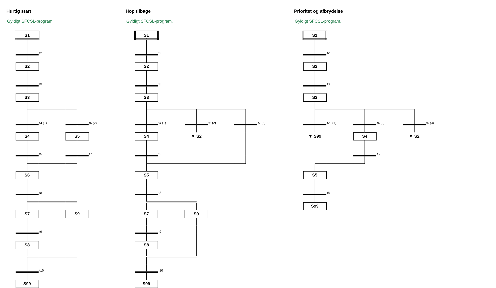

# SFCSL i Google Sheets

`SFCSL.gs` er et Google Apps Script. Du skriver et SFCSL-program i arket **SFCSL**, og scriptet tegner SFC-diagrammet i arket **SFC** med celler og kanter.



Diagrammet tegnes sådan:

| SFC-element | Tegnes som |
|---|---|
| Starttrin | Firkant med dobbelt ramme |
| Trin | Firkant |
| Transition | Tyk vandret streg med navnet til højre |
| Alternativ forgrening `( … )` | Enkelt vandret linje, med prioritet (1), (2) … |
| Parallel forgrening `[ … ]` | Dobbelt vandret linje |
| Hop `>> S2` | ▼ S2 |

## Installation (én gang)

1. Opret et nyt regneark på https://sheets.new.
2. Vælg menuen **Udvidelser → Apps Script**. Der åbnes en kodeeditor i en ny fane.
3. Slet den kode, der står der i forvejen (`function myFunction() {}`).
4. Kopiér hele indholdet af `SFCSL.gs` og indsæt det. På GitHub kan du åbne filen og trykke på kopiknappen (to firkanter) øverst til højre over koden.
5. Tryk på diskette-ikonet (**Gem projekt**).
6. Gå tilbage til regnearket og genindlæs siden (F5).
7. Efter et par sekunder kommer der en ny menu **SFCSL** øverst. Vælg **SFCSL → Opret ark med eksempel**.
8. Første gang beder Google om lov til, at scriptet må ændre i regnearket:
   - Tryk **Fortsæt** og vælg din Google-konto.
   - Hvis Google skriver "Google har ikke bekræftet denne app", så tryk **Avanceret** og derefter **Gå til … (usikkert)**. Advarslen kommer, fordi det er dit eget script, og Google ikke har gennemgået det.
   - Tryk **Tillad**.
9. Vælg **SFCSL → Opret ark med eksempel** igen, hvis der ikke skete noget første gang.

Nu har du to ark: **SFCSL** med et eksempelprogram og **SFC** med diagrammet.

## Brug

- Skriv SFCSL i kolonne A i arket **SFCSL**, én linje pr. celle. Indrykning med mellemrum er tilladt, og `//` starter en kommentar.
- Diagrammet tegnes igen automatisk, hver gang du ændrer i SFCSL-arket. Du kan også bruge **SFCSL → Tegn SFC**.
- Celle A1 i **SFC**-arket viser, om programmet er gyldigt. Fejl vises med rød tekst, og brud på reglerne (fx hop ind i en parallel gren) med orange.

## Indstillinger

Øverst i Google Sheets-delen af scriptet står:

```js
const ARK_SFCSL = 'SFCSL';       // navnet på arket med SFCSL
const ARK_SFC = 'SFC';           // navnet på arket med diagrammet
const VIS_PRIORITET = true;      // vis (1), (2) ... på alternative grene
const TEGN_AUTOMATISK = true;    // tegn igen, hver gang SFCSL-arket ændres
```

Sæt `TEGN_AUTOMATISK = false`, hvis det bliver langsomt ved store programmer. Så tegnes der kun, når du vælger **Tegn SFC** i menuen.

## Opbygning af koden

1. **Tokenizer, parser og validering**: præcis den samme kode som i `sfcsl-mermaid-editor.html`.
2. **`layoutSFC`**: regner ud, hvilke celler der skal have tekst og kanter. Hver gren i diagrammet fylder tre kolonner: to til trinnet og én til transitionsnavnet. Den lodrette linje er højre kant af den første kolonne.
3. **`tegnSFC` og `skrivModel`**: læser arket, kalder parseren og skriver resultatet ind i arket med så få kald som muligt, fordi Apps Script er langsomt, når man ændrer én celle ad gangen.
